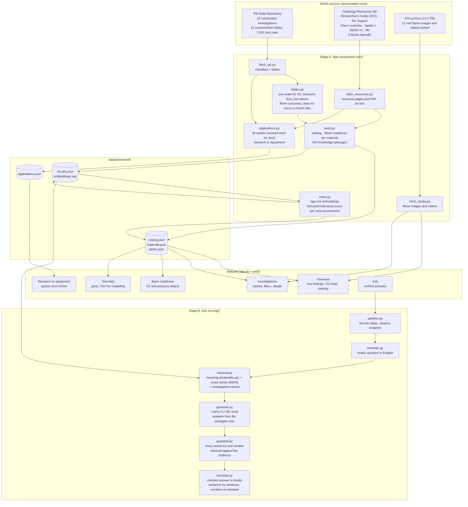
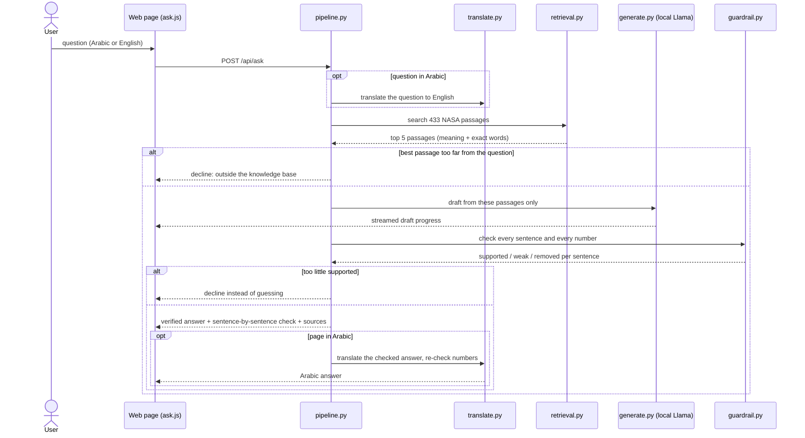

# TrustFlame architecture

TrustFlame turns NASA's Physical Sciences Informatics (PSI) combustion data into a bilingual fire-safety dashboard,
with an assistant that answers only from NASA sources and checks every sentence before showing it.
Everything runs on one ordinary laptop, offline after the first download: no cloud, no paid API.

## The whole system

## How one question is answered

## Files

| Part | File | What it does |
|---|---|---|
| Settings | `src/config.py` | paths, NASA endpoints, local model names |
| Data | `src/fetch_psi.py` | downloads the 24 PSI investigations and their 22 test tables |
| | `src/fetch_resources.py` | downloads every resource in the challenge's Resources tab as text |
| | `src/fetch_media.py` | downloads 12 real flame images and videos (43 MB of the 12.3 TiB archive) |
| | `src/tables.py` | puts O2, pressure, flow and fuel names on one scale; reads flame outcomes; fixes known errors in NASA files |
| | `src/build.py` | builds the catalog, the Moon-readiness list and the 433 knowledge passages |
| | `src/applications.py` | checks each research-to-equipment quote word for word against its NASA source |
| | `src/index.py` | embeddings (bge-m3) and the 100-point relevance score per crew environment |
| Ask | `src/rag/embedder.py` | text to vector |
| | `src/rag/retrieval.py` | hybrid search: meaning + exact words + investigation names |
| | `src/rag/generate.py` | local Llama 3.2 drafts from the passages only |
| | `src/rag/guardrail.py` | checks every sentence and number; decides accept / partial / decline |
| | `src/rag/translate.py` | Arabic question in, checked answer out, numbers re-checked |
| | `src/rag/pipeline.py` | runs the steps and streams progress |
| | `src/rag/settings.py` | every threshold in one place |
| Website | `app.py` | FastAPI server: pages, JSON API, video streaming |
| | `web/app.js` | overview, investigations, details panel, Arabic / English |
| | `web/moon.js` | Moon readiness tool |
| | `web/data.js` | test-data explorer and CSV export |
| | `web/ask.js` | Ask page and verified summaries |
| | `web/charts.js` | charts without any library |

## Design choices

- **Never invent.** The assistant answers from retrieved NASA passages only, and every sentence is checked. Unsupported sentences are removed in front of the user. If too little is supported, it declines instead of guessing.
- **Numbers are checked separately.** Meaning-based similarity cannot tell "21% O2" from "34% O2". Every number in an answer must appear in the evidence.
- **No invented risk score.** There is no validated formula that turns a NASA test into a "Moon fire risk". The Moon readiness tool counts what NASA actually tested and shows where data is missing.
- **Hand-written links are verified.** Every research-to-equipment link quotes NASA word for word, and the build stops if a quote is not found.
- **Data errors are reported, not hidden.** Known errors inside NASA files (spreadsheet auto-fill, lost subscripts, samples named only by shape) are corrected on read and shown as data notes.
- **Offline and cheap.** Local models through Ollama, one CPU, no subscription: suited to a Moon base where the Earth link is slow and not always available.
- **Two languages.** Arabic and English with one button; checking always happens on the English text.

## Limitations

- On a laptop CPU an answer takes 1 to 2 minutes.
- The guardrail uses embedding similarity plus a number check, not a trained entailment model; its thresholds were set by hand on a few examples, not on a labelled benchmark.
- Arabic answers are machine translations by a small model; sentences that fail the number and name check stay in English.
- PSI has no partial-gravity data yet, and its flame outcomes are recorded in only a few tables (FLEX, CFI-G, Saffire-II).
- PSI has no documented API; the download scripts use the endpoints of the psi.nasa.gov web app, which may change.
